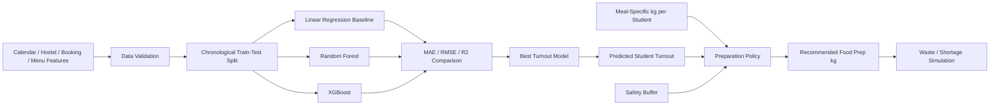

# AI-Driven Hostel Food Waste Mitigation and Demand Forecasting System

A reproducible engineering capstone for forecasting hostel meal turnout and converting demand predictions into operational food-preparation recommendations. The repository contains a realistic **synthetic data generator**, a chronological machine-learning evaluation pipeline, Random Forest and XGBoost ensemble models, deployment-style single-meal inference, tests, model artifacts, and an IEEE-style conference-paper draft.

> **Research integrity notice**
> The bundled dataset is synthetically generated for engineering development and academic demonstration. It does **not** represent measurements collected from a real hostel. Any publication or presentation using the included results must clearly identify them as synthetic/simulation results and should validate the approach on real institutional data before making empirical claims.

## 1. Problem Statement

Hostel kitchens typically prepare meals before exact turnout is known. Attendance changes with meal type, menu popularity, examinations, weekends, vacations, events, and environmental conditions. Conservative over-preparation protects service levels but increases edible food waste and cost. This project frames the task as a two-stage decision system:

1. **Demand forecasting:** predict student turnout for each meal using only information available before service.
2. **Operational recommendation:** translate predicted turnout into kilograms of food using meal-specific historical consumption and a configurable safety buffer.

The separation prevents target leakage and makes the recommendation policy auditable.

## 2. System Architecture



## 3. Repository Blueprint

```text
hostel-food-waste-ai/
├── .github/
│   └── workflows/
│       └── ci.yml
├── README.md
├── LICENSE
├── requirements.txt
├── .gitignore
├── data/
│   ├── .gitkeep
│   ├── hostel_food_waste.csv
│   └── hostel_food_waste_summary.json
├── docs/
│   └── ieee_paper_draft.md
├── examples/
│   └── next_meal.json
├── models/
│   ├── .gitkeep
│   ├── best_turnout_model.joblib
│   └── model_metadata.json
├── reports/
│   ├── .gitkeep
│   ├── model_metrics.csv
│   └── holdout_predictions.csv
├── src/
│   ├── generate_synthetic_data.py
│   ├── train_predictive_pipeline.py
│   └── predict.py
└── tests/
    └── test_data_and_pipeline.py
```

## 4. Synthetic Dataset

The default generator creates **2,193 meal records** from 1 January 2024 through 31 December 2025, with one record each for breakfast, lunch, and dinner. Important variables include:

| Group | Variables |
|---|---|
| Calendar | date, year, month, day of week, weekend flag |
| Academic context | exam, vacation, festival, special-event flags |
| Hostel demand | hostel capacity, residents present, advance bookings |
| Meal context | meal category, menu name, menu popularity |
| Environment | temperature, rain index |
| Operational outcomes | student turnout, food consumed, prepared, wasted, waste percentage, waste cost |

The generator includes hard validation for missing values, impossible attendance, negative waste, and record count.

## 5. Installation

### Windows PowerShell

```powershell
python -m venv .venv
.\.venv\Scripts\Activate.ps1
python -m pip install --upgrade pip
pip install -r requirements.txt
```

### Linux / macOS

```bash
python3 -m venv .venv
source .venv/bin/activate
python -m pip install --upgrade pip
pip install -r requirements.txt
```

Python 3.10+ is recommended.

## 6. Reproduce the Dataset

From the repository root:

```bash
python src/generate_synthetic_data.py \
  --output data/hostel_food_waste.csv \
  --start-date 2024-01-01 \
  --end-date 2025-12-31 \
  --hostel-capacity 520 \
  --seed 42
```

Expected default output:

```text
Generated 2,193 synthetic meal records -> data/hostel_food_waste.csv
Date range: 2024-01-01 to 2025-12-31
Mean food-waste rate: approximately 10.9%
```

## 7. Train and Evaluate Models

```bash
python src/train_predictive_pipeline.py \
  --data data/hostel_food_waste.csv \
  --output-dir reports \
  --model-dir models \
  --train-fraction 0.80 \
  --safety-buffer 0.03 \
  --seed 42
```

The split is chronological rather than random: the first 80% of dates are used for training and the final 20% for testing. This is more realistic for forecasting and reduces temporal leakage.

### Reproduced default metrics

| Model | MAE (students) | RMSE (students) | R² |
|---|---:|---:|---:|
| Linear Regression | 10.158 | **12.825** | **0.9736** |
| XGBoost | **10.118** | 13.044 | 0.9727 |
| Random Forest | 10.565 | 13.521 | 0.9706 |

Under the default synthetic generator, the linear baseline obtains the lowest RMSE while XGBoost obtains the lowest MAE. This is not a contradiction: the synthetic process contains strong structured and approximately linear components, while the ensemble models remain competitive. Real hostel data may produce a different ranking.

### Default operational simulation

The best-RMSE model is translated into food-preparation weights using the training-set median consumption per attending student and a 3% safety buffer.

| Indicator | Holdout result |
|---|---:|
| Actual prepared food | 76,234.07 kg |
| Recommended prepared food | 71,418.43 kg |
| Change in prepared food | -6.317% |
| Recorded synthetic waste | 8,423.00 kg |
| Simulated leftover under recommendation | 2,600.69 kg |
| Simulated leftover reduction | 69.124% |
| Simulated shortage | 749.03 kg |
| Shortage as % of consumption | 1.077% |

These figures are **simulation results on synthetic data** and should not be interpreted as measured institutional savings.

## 8. Single-Meal Inference

Edit `examples/next_meal.json`, then run:

```bash
python src/predict.py --input examples/next_meal.json
```

Example output structure:

```json
{
  "date": "2026-01-12",
  "meal_category": "Lunch",
  "predicted_turnout": 425,
  "recommended_food_prep_kg": 236.07,
  "safety_buffer_pct": 3.0,
  "model": "LinearRegression"
}
```

The actual numeric prediction depends on the fitted artifact.

## 9. Mathematical Policy

Let \(\hat{N}_{t,m}\) be predicted turnout for date \(t\) and meal \(m\), \(q_m\) the robust training-set estimate of kilograms consumed per attending student, and \(b\) the safety-buffer fraction. The preparation recommendation is

\[
\hat{P}_{t,m}=\hat{N}_{t,m}q_m(1+b).
\]

For retrospective evaluation, simulated leftover and shortage are

\[
L_{t,m}=\max(\hat{P}_{t,m}-C_{t,m},0),
\qquad
S_{t,m}=\max(C_{t,m}-\hat{P}_{t,m},0),
\]

where \(C_{t,m}\) is realized food consumption. The buffer can therefore be tuned as a service-level trade-off rather than embedded invisibly in the model.

## 10. Testing

```bash
pytest -q
```

Tests check that the generator creates more than 1,500 valid records and that preparation recommendations are nonnegative and operationally bounded.

## 11. GitHub Setup

```bash
git init
git add .
git commit -m "Initial AI hostel food-waste forecasting capstone"
git branch -M main
git remote add origin https://github.com/<YOUR_USERNAME>/hostel-food-waste-ai.git
git push -u origin main
```

Before pushing, replace `<YOUR_USERNAME>` with your GitHub username. Large model artifacts can be excluded or managed with Git LFS in a production repository.

## 12. Recommended Engineering Extensions

For a real deployment, replace synthetic data with audited mess/hostel records, connect attendance/booking systems through APIs, add drift monitoring, use prediction intervals or quantile regression for uncertainty-aware buffers, add meal-item-level optimization, expose inference through FastAPI, and log actual attendance/consumption so the model can be retrained on a controlled schedule.

## 13. Research Reproducibility

The code fixes random seeds, stores model metadata, keeps train/test dates explicit, records the consumption conversion policy, and writes row-level holdout predictions. The paper draft in `docs/ieee_paper_draft.md` reports only reproducible results from the bundled pipeline and labels them as synthetic experiments.

## 14. Citation and Sustainability Context

The project is motivated by SDG 12.3, which calls for halving per-capita food waste at retail and consumer levels by 2030. The literature cited in the paper draft includes institutional/catering demand-forecasting studies and the original Random Forest and XGBoost methods.

## License

MIT. See `LICENSE`.
