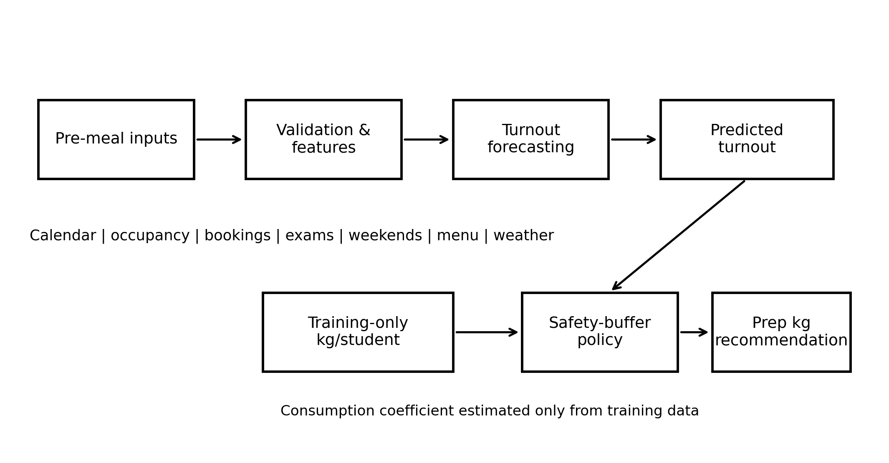
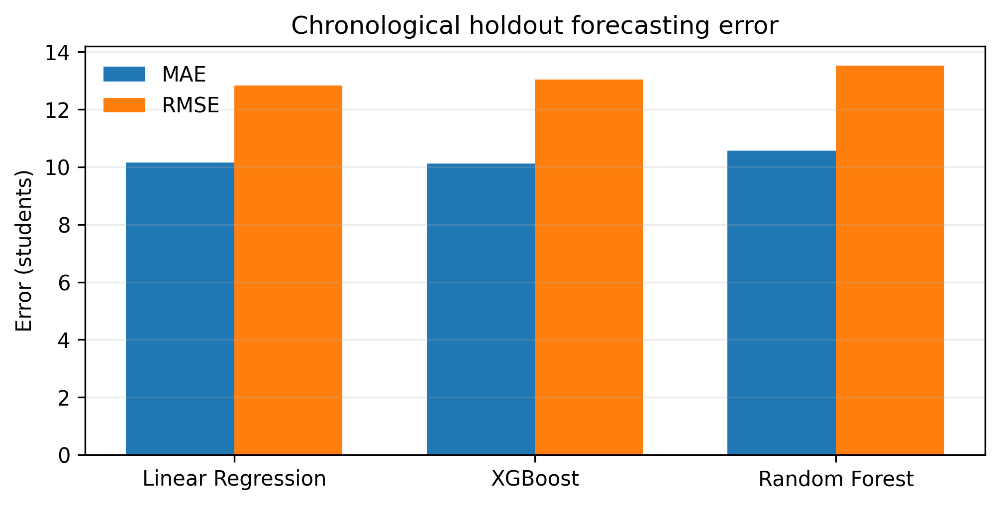
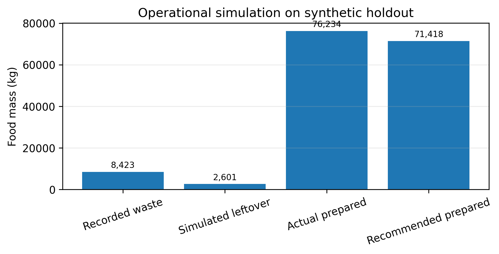

# AI-Driven Hostel Food Waste Mitigation and Demand Forecasting System: A Reproducible Machine-Learning Framework for Institutional Dining

**Author(s):** *Replace with author names, affiliations, and e-mail addresses before submission.*

## Abstract

Institutional hostels must prepare meals before exact student participation is known, creating a recurring trade-off between service availability and avoidable food waste. This paper presents an AI-driven demand-forecasting and preparation-recommendation framework for hostel dining operations. The system is designed as a reproducible engineering pipeline comprising: (i) a synthetic meal-level data generator for controlled experimentation; (ii) leakage-aware preprocessing and chronological train-test evaluation; (iii) Linear Regression, Random Forest, and XGBoost regression models for student-turnout forecasting; and (iv) an operational policy that converts forecast attendance into recommended preparation weight using meal-specific per-student consumption and a configurable safety buffer. The default synthetic dataset contains 2,193 breakfast, lunch, and dinner observations spanning two years, with explanatory variables representing hostel occupancy, advance bookings, menu popularity, examinations, weekends, vacations, special events, temperature, and rainfall intensity. On a chronological holdout of 441 observations, Linear Regression achieved MAE 10.158 students, RMSE 12.825 students, and R² 0.9736; XGBoost achieved the lowest MAE at 10.118 students with RMSE 13.044 and R² 0.9727, while Random Forest achieved MAE 10.565, RMSE 13.521, and R² 0.9706. A retrospective operational simulation with a 3% buffer reduced modeled leftover food from 8,423.00 kg to 2,600.69 kg while introducing simulated shortage equivalent to 1.077% of realized consumption. These results demonstrate the engineering feasibility of coupling demand prediction with an explicit preparation decision rule. Because the experiments use synthetic data, the reported savings are simulation outcomes and require validation on real hostel records before institutional or causal claims are made.

**Index Terms—** food waste, demand forecasting, hostel dining, institutional catering, machine learning, Random Forest, XGBoost, sustainability, decision support.

---

## I. Introduction

Food waste is a sustainability, cost, and resource-allocation problem across households, retail, and food-service systems. The United Nations Sustainable Development Goal (SDG) 12.3 calls for halving per-capita global food waste at retail and consumer levels by 2030 [1]. The United Nations Environment Programme (UNEP) Food Waste Index Report 2024 further emphasizes the need for systematic measurement and practical waste-reduction interventions across food-service settings [2]. For institutional kitchens, one particularly actionable intervention is to improve the decision made before a meal is prepared: **how many people are likely to eat, and how much food should be produced?**

Hostel dining is a useful engineering context because meal demand is recurrent yet non-stationary. Student participation varies by breakfast, lunch, and dinner; by weekday and weekend; during examinations and vacations; with menu popularity; and in response to temporary events. Kitchen staff commonly compensate for this uncertainty by preparing a safety surplus. The surplus protects service quality but increases leftover food if the estimated turnout is too high. Conversely, aggressive reductions in preparation may create shortages and reduce service reliability. A deployable system therefore should not optimize forecast accuracy in isolation. It should connect prediction to a transparent operational policy that exposes the waste-versus-shortage trade-off.

Prior work supports the relevance of data-driven forecasting in catering. Rodrigues *et al.* evaluated machine-learning demand forecasting across catering services and reported that improved forecasting could reduce wasted meals while also reducing unmet demand relative to baseline approaches [3]. Faezirad *et al.* modeled university dining attendance and reservation behavior for food-waste prevention [4]. Recent campus-focused work has applied regression models including XGBoost for meal-demand estimation [5], while Aydın *et al.* compared XGBoost, LSTM, and Prophet for institutional cafeteria forecasting [6]. Public catering research by Malefors *et al.* has similarly shown that machine-learning attendance forecasts can create economic and waste-reduction opportunities, particularly when demand patterns are disrupted [7].

Despite this progress, three practical gaps frequently arise in student capstone implementations. First, many demonstrations use random train-test splits even when the deployment problem is temporal forecasting, which can yield optimistic estimates. Second, target leakage may occur if variables available only after food preparation—such as actual food prepared, actual waste, or realized attendance-derived quantities—are included among predictive features. Third, a model may predict attendance without specifying how that prediction should influence the final kitchen decision. Forecasting alone does not determine a preparation quantity unless a consumption model and service-level buffer are defined.

This work addresses these gaps through a deliberately modular engineering architecture. The forecasting layer is restricted to pre-meal information. Data are split chronologically so that the model is evaluated on later dates than those used for training. The operational layer then estimates a robust meal-specific consumption rate in kilograms per attending student and applies a configurable safety margin. The resulting system produces two outputs useful to a kitchen manager: expected turnout and recommended preparation mass.

The contributions of this paper are as follows:

1. A reproducible synthetic dataset generator producing more than 1,500 meal-level observations with realistic operational, academic, menu, and environmental factors.
2. A leakage-aware forecasting pipeline comparing a linear baseline with Random Forest and XGBoost ensemble regressors using MAE, RMSE, and R².
3. A mathematically explicit food-preparation policy linking predicted turnout to kilograms of food while separately measuring simulated leftovers and shortages.
4. A chronological evaluation design and complete GitHub-ready implementation supporting reproducibility, testing, model serialization, and single-meal inference.
5. A transparent research-integrity boundary: all reported experimental results are identified as synthetic simulation results rather than empirical hostel measurements.

The remainder of the paper reviews related work, formalizes the prediction and decision problem, presents the architecture and dataset design, reports experimental results, and discusses deployment implications and limitations.

## II. Related Work

### A. Food Waste in Institutional and Food-Service Systems

Food-service waste is influenced by planning, customer behavior, menu design, serving practices, and the mismatch between production and realized consumption. Dhir *et al.* reviewed food waste in hospitality and food services and organized prior research around generation drivers, waste-reduction practices, stakeholder behavior, and leftover handling [8]. Such evidence motivates upstream interventions that prevent excess production rather than dealing only with food after it becomes waste.

UNEP's Food Waste Index work provides a global measurement context and emphasizes systematic measurement across food-service and other consumer-facing sectors [2]. At the operational scale, institutional dining creates an especially measurable setting because demand can be observed repeatedly at scheduled meals, and explanatory variables such as bookings, academic calendars, menu plans, and occupancy are often available in structured information systems.

### B. Demand Forecasting for Catering and Canteens

Rodrigues *et al.* compared machine-learning forecasting methods using real catering-service datasets covering multiple years. Their results showed that Random Forest and LSTM models could improve demand estimates and that better predictions could translate into lower waste and unmet demand [3]. Their study is particularly relevant because it evaluates the downstream operational consequences of forecasts rather than treating forecasting metrics as the only objective.

Posch *et al.* developed a Bayesian approach for food and beverage sales prediction in staff canteens and restaurants, highlighting the role of accurate forecasting in purchasing and pre-consumer waste reduction [9]. Public catering research by Eriksson and colleagues also demonstrated the potential value of machine-learning attendance prediction under the distributional disruption associated with the COVID-19 period [7]. These studies support a broader conclusion: food-service demand contains structured patterns but can be affected by calendar changes, behavior, and exogenous events.

In university dining, Faezirad *et al.* explicitly modeled reservations and show/no-show behavior and used an artificial-neural-network-aided formulation to support waste prevention [4]. Turker examined campus dining demand using multiple machine-learning regressors, including XGBoost, and emphasized links among campus density, food preferences, and required meal counts [5]. Aydın *et al.* compared XGBoost, LSTM, and Prophet in an institutional demand-forecasting case, showing that different methods may perform differently depending on temporal resolution and forecasting horizon [6].

### C. Machine Learning for Food-Waste Monitoring and Prediction

Machine learning is also being used beyond demand forecasting. Li *et al.* proposed a machine-vision recognition approach to identify food waste in university cafeterias [10]. More recent work has examined direct prediction of waste quantity in large-scale dining facilities [11]. These directions are complementary to the current work. Vision and weighing systems can quantify what was wasted after service, whereas demand forecasting aims to prevent a portion of that waste before production.

From a modeling perspective, Random Forest is a robust bagging ensemble that averages decorrelated decision trees and can capture nonlinearities and interactions without requiring strong parametric assumptions [12]. XGBoost is a gradient-boosted decision-tree framework designed for regularized, scalable learning and has become common in tabular prediction tasks [13]. These models are appropriate candidates for meal-demand forecasting because attendance may depend nonlinearly on occupancy, bookings, meal type, calendar state, weather, and menu characteristics.

### D. Research Gap and Positioning

Existing work establishes the value of demand forecasting, but an engineering capstone still needs careful separation between four concepts: **inputs available before a meal**, **forecast target**, **consumption conversion**, and **operational decision rule**. The present framework makes those boundaries explicit. Actual prepared kilograms and actual waste are excluded from turnout-model features because they are post-decision variables. The model predicts attendance first. A second layer then converts attendance to preparation mass. This modularity improves interpretability, supports service-level tuning, and reduces the risk that a high evaluation score is caused by leakage.

A further distinction is the use of a synthetic generator as a development instrument. Synthetic data allow the software, validation rules, modeling pipeline, and reproducibility mechanisms to be tested before sensitive institutional records are available. However, synthetic experiments cannot establish field effectiveness. Accordingly, this study positions its results as an engineering demonstration and defines real-world validation as a required next phase.

## III. Problem Definition and Mathematical Formulation

Let each observation correspond to date \(t\) and meal category \(m\in\{B,L,D\}\), representing breakfast, lunch, and dinner. Define the pre-meal feature vector

\[
\mathbf{x}_{t,m} = [\mathbf{c}_t,\mathbf{h}_t,\mathbf{a}_t,\mathbf{u}_{t,m},\mathbf{e}_t],
\]

where \(\mathbf{c}_t\) contains calendar variables, \(\mathbf{h}_t\) hostel occupancy and booking variables, \(\mathbf{a}_t\) academic-status variables such as examinations and vacations, \(\mathbf{u}_{t,m}\) meal and menu variables, and \(\mathbf{e}_t\) environmental variables.

The first-stage supervised-learning problem is

\[
\hat{N}_{t,m}=f_{\theta}(\mathbf{x}_{t,m}),
\]

where \(N_{t,m}\) is realized student turnout and \(f_{\theta}\) is a fitted regression model. Three model classes are evaluated: Linear Regression, Random Forest Regression, and XGBoost Regression.

Forecast accuracy is measured using Mean Absolute Error (MAE), Root Mean Squared Error (RMSE), and coefficient of determination \(R^2\):

\[
\mathrm{MAE}=\frac{1}{n}\sum_{i=1}^{n}|N_i-\hat{N}_i|,
\]

\[
\mathrm{RMSE}=\sqrt{\frac{1}{n}\sum_{i=1}^{n}(N_i-\hat{N}_i)^2},
\]

\[
R^2=1-\frac{\sum_i(N_i-\hat{N}_i)^2}{\sum_i(N_i-\bar{N})^2}.
\]

The second stage converts predicted attendance into a preparation recommendation. For each meal category \(m\), let \(q_m\) be the median kilograms consumed per attending student estimated **only from the training partition**:

\[
q_m=\operatorname{median}_{(t,m)\in\mathcal{T}}
\left(\frac{C_{t,m}}{N_{t,m}}\right),
\]

where \(C_{t,m}\) is realized food consumption and \(\mathcal{T}\) denotes training data. For safety buffer \(b\geq0\), recommended preparation is

\[
\hat{P}_{t,m}=\hat{N}_{t,m}\,q_m(1+b).
\]

This policy is intentionally simple and auditable. The parameter \(b\) captures the institution's service-level tolerance. A larger value reduces shortage risk but increases potential leftovers.

For retrospective analysis, simulated leftover and shortage are defined as

\[
L_{t,m}=\max(\hat{P}_{t,m}-C_{t,m},0),
\]

\[
S_{t,m}=\max(C_{t,m}-\hat{P}_{t,m},0).
\]

The operational goal is therefore multi-objective: minimize forecast error and leftover food while constraining shortage to an acceptable level. A future deployment can select \(b\) by solving

\[
\min_b \; \alpha\sum L_{t,m}+\beta\sum S_{t,m},
\]

where \(\alpha\) represents the cost of waste and \(\beta\) represents the higher service penalty that may be assigned to shortages.

## IV. Dataset and Synthetic Data Generator

### A. Purpose of Synthetic Data

The dataset generator is included so that the complete engineering pipeline can be executed without exposing student records or claiming access to institutional measurements. The generator is deterministic under a fixed random seed and contains explicit validation rules. It should be replaced with audited operational data for a real study.

The default period is 1 January 2024 through 31 December 2025. Three meal observations are generated per day, producing 2,193 records. Hostel capacity is fixed at 520 in the default configuration, while the number of residents physically present varies according to weekends, examination periods, vacations, festival periods, and random day-to-day variation.

### B. Variables

The dataset includes the following groups.

**1) Calendar variables:** year, month, day of week, day name, and weekend indicator.

**2) Academic variables:** examination, vacation, festival, and special-event flags.

**3) Hostel variables:** hostel capacity, residents present, and advance bookings.

**4) Meal variables:** breakfast/lunch/dinner category, menu name, and menu-popularity score.

**5) Environmental variables:** temperature and normalized rain-intensity index.

**6) Outcomes:** student turnout, average consumption per attending student, food consumed, food prepared, food wasted, waste percentage, and estimated waste cost.

The generator assigns different base turnout and portion-consumption profiles to breakfast, lunch, and dinner. Menu popularity modifies turnout, while examinations, weekends, events, rainfall, and temperature introduce systematic and stochastic variation. Food preparation is generated by applying conservative planning noise and a meal-specific surplus to realized consumption, after which a small plate-waste component is added.

### C. Validation

Before a generated dataset is written, the software checks that (i) more than 1,500 observations exist, (ii) no required values are missing, (iii) attendance never exceeds residents present, (iv) waste is nonnegative, and (v) prepared food is strictly positive. These checks are important because a synthetic generator can otherwise silently produce impossible records that inflate or destabilize downstream models.

## V. Model Architecture and Implementation

### A. Leakage-Aware Feature Boundary

Only variables plausibly available before meal preparation are used to predict turnout: calendar fields, residents present, advance bookings, academic flags, temperature, rain index, meal category, menu name, and menu-popularity score. The model excludes realized food consumption, prepared food, and wasted food.

Categorical features are one-hot encoded with unknown-category handling. Numeric variables are median-imputed and standardized. Although the current synthetic dataset contains no missing values, keeping imputation in the production pipeline protects deployment against incomplete records.

### B. Chronological Evaluation

A random row split would allow records from late dates to appear in the training set while earlier dates appear in the test set. That is inconsistent with the intended use case, where a trained model predicts future meals. The implementation therefore sorts by date, identifies unique dates, and assigns the earliest 80% of dates to training and the latest 20% to testing. Whole dates are kept together so breakfast, lunch, and dinner from the same date cannot be split across partitions.

The default run produced 1,752 training observations from 1 January 2024 to 6 August 2025 and 441 holdout observations from 7 August 2025 to 31 December 2025.

### C. Candidate Models

**Linear Regression** is used as a strong interpretable baseline because much of institutional demand can be explained through additive effects and bookings.

**Random Forest** uses 450 regression trees, bounded depth, minimum leaf-size regularization, feature subsampling, and parallel fitting. It is expected to capture nonlinear interactions, threshold behavior, and heterogeneous effects without a manually specified functional form [12].

**XGBoost** uses histogram-based gradient-boosted trees with shrinkage, row and column subsampling, L1/L2 regularization, and a squared-error objective [13]. It is included because gradient boosting frequently performs strongly on heterogeneous tabular data.

All models share the same chronological partitions and the same permitted predictor set.

### D. Architecture

The system is organized as the following data flow:

```text
Pre-meal data
    |
    v
Schema and range validation
    |
    v
Calendar feature derivation
    |
    v
Chronological split ------------------------------+
    |                                              |
    +--> Linear Regression                         |
    +--> Random Forest --------> Metrics ----------+--> Best RMSE model
    +--> XGBoost                                    |
                                                   v
                                          Predicted turnout
                                                   |
Training consumption -> median kg/student by meal |
                                                   v
                                          Safety-buffer policy
                                                   |
                                                   v
                                     Recommended preparation kg
                                                   |
                                                   v
                                 Leftover / shortage simulation
```

The trained best model is serialized with Joblib. Model metadata store the training/test ranges, selected model name, safety buffer, meal-specific consumption coefficients, and aggregated operational simulation. A separate inference script accepts JSON pre-meal features and returns predicted turnout and recommended kilograms.

{#fig:architecture width=95%}

## VI. Experimental Results

### A. Forecasting Performance

Table I reports results for the chronological holdout.

**TABLE I. TURNOUT FORECASTING PERFORMANCE ON SYNTHETIC HOLDOUT DATA**

| Model | MAE (students) | RMSE (students) | R² |
|---|---:|---:|---:|
| Linear Regression | 10.158 | **12.825** | **0.9736** |
| XGBoost | **10.118** | 13.044 | 0.9727 |
| Random Forest | 10.565 | 13.521 | 0.9706 |

The three methods perform similarly, with R² values above 0.97. XGBoost obtains the lowest MAE, while Linear Regression obtains the lowest RMSE and highest R². Under the repository's model-selection rule, the Linear Regression pipeline is therefore serialized as the best model.

{#fig:modelerrors width=95%}

This result is informative rather than problematic. The synthetic generator contains strong structured relationships among residents present, bookings, meal category, and turnout. Although nonlinearities and interactions are included, the resulting data-generating process remains sufficiently regular that a linear model can approximate it well. In a real hostel, attendance behavior may contain more abrupt nonlinearities, cohort effects, menu-specific preferences, academic-event interactions, and drift, potentially changing the model ranking. The inclusion of Random Forest and XGBoost in the package is therefore valuable even though they do not dominate the default synthetic run.

MAE and RMSE should also be interpreted in operational terms. An MAE of approximately ten students means that the forecast is typically wrong by about ten attendees per meal in the synthetic holdout. For a lunch consumption coefficient near 0.54 kg per attending student, such an error corresponds to roughly 5.4 kg before applying a safety buffer. This direct relationship between forecast error and kilograms motivates the second-stage preparation policy.

### B. Consumption Coefficients

Training data produced the median per-student consumption coefficients shown in Table II.

**TABLE II. TRAINING-SET MEDIAN CONSUMPTION PER ATTENDING STUDENT**

| Meal | Median kg/student |
|---|---:|
| Breakfast | 0.3599 |
| Lunch | 0.5393 |
| Dinner | 0.4904 |

These coefficients are estimated only from training observations, preventing test-set outcomes from influencing the recommendation formula.

### C. Operational Simulation

Using the best-RMSE forecast model and a 3% safety buffer, recommended preparation is calculated for each holdout meal. Table III summarizes the results.

**TABLE III. RETROSPECTIVE PREPARATION-POLICY SIMULATION**

| Metric | Value |
|---|---:|
| Actual synthetic food prepared | 76,234.07 kg |
| Recommended preparation | 71,418.43 kg |
| Change in preparation | -6.317% |
| Recorded synthetic waste | 8,423.00 kg |
| Simulated leftover under recommendation | 2,600.69 kg |
| Simulated leftover reduction | 69.124% |
| Simulated shortage | 749.03 kg |
| Shortage / realized consumption | 1.077% |

The simulation suggests that forecast-guided preparation can substantially reduce modeled leftovers, but it also demonstrates why waste reduction cannot be evaluated without shortage. If the system minimized preparation mass alone, waste could be driven down by systematically under-serving students. The explicit shortage metric reveals this failure mode.

The default 3% buffer yields simulated shortages equal to 1.077% of realized food consumption over the holdout. A production deployment should calibrate this parameter with institutional policy. For example, a hostel may prefer a larger buffer during lunch, examination periods, or high-variability menus. More advanced extensions could predict conditional quantiles rather than a single expected turnout and select preparation from a desired service percentile.

{#fig:ops width=95%}

### D. Comparison with Prior Work

The direction of the simulation is consistent with prior literature arguing that improved demand estimates can reduce overproduction in catering [3], [7]. However, the magnitude of the 69.124% simulated leftover reduction must **not** be compared directly with empirical reductions reported by other studies. The current figure is generated under a synthetic data-generating process in which actual preparation is intentionally conservative. It demonstrates how the decision policy behaves under controlled assumptions, not how much waste a real institution would save.

### E. Reproducibility

The repository fixes random seeds, saves the generated dataset, stores full row-level holdout predictions, records model metadata, and exposes all hyperparameters in source code. The complete experiment can be reproduced with two commands: one to generate data and one to train/evaluate models. Unit tests validate minimum dataset size and recommendation bounds. These features make the package suitable for interview demonstration, capstone assessment, and extension to real records.

## VII. Discussion

### A. Why Forecasting and Recommendation Are Separated

A key architectural choice is not to train a model that directly predicts “food to prepare” using historical prepared-food values. Historical preparation is itself a human decision and can encode past overproduction practices. A model trained to imitate it may reproduce waste rather than reduce it. The proposed architecture predicts turnout, estimates consumption, and then applies an explicit policy. This makes the decision logic observable and tunable.

The same separation also supports governance. Kitchen managers can adjust the safety buffer without retraining the demand model. They can review meal-specific consumption coefficients and compare predictions with bookings. If an institution decides that shortage is five times more costly than leftover food, the policy layer can reflect that operational preference.

### B. Feature Availability and Deployment

The current features are plausible for a digital hostel environment. Residents present can be estimated from occupancy/leave systems; advance bookings can come from a meal-booking portal; exam and vacation flags can come from an academic calendar; menu information comes from kitchen planning; and weather can be obtained through external APIs. A real deployment should record the timestamp at which each feature becomes available to ensure that training faithfully represents inference-time conditions.

### C. Model Monitoring

Deployment creates several monitoring requirements. Prediction error should be tracked by meal category, day type, exam status, and menu. Data drift can be detected when distributions of bookings, occupancy, or menu categories move away from the training baseline. Operational monitoring should track both leftover kilograms and shortage events. A low model RMSE is insufficient if systematic under-preparation occurs for a subgroup of meals.

### D. Privacy and Data Minimization

The proposed model does not require personally identifiable student attributes. Aggregate counts—residents present and advance bookings—are sufficient for the baseline architecture. This is preferable for privacy and simplifies governance. If future research introduces cohort, dietary, or demographic variables, institutional approval, minimization, access control, and fairness analysis should be considered.

### E. Limitations

The most important limitation is the synthetic nature of the current dataset. The generator encodes assumed relationships, and models trained on those relationships may recover the generator rather than discover unknown behavior. High R² values therefore demonstrate software and modeling consistency, not field generalization.

Second, the operational simulation assumes that consumed kilograms are an appropriate demand proxy and that preparation can be scaled proportionally by attendance. Real kitchens prepare menu items in batches and may face minimum batch sizes, ingredient constraints, recipe yields, dietary categories, and uncertain plate waste. Third, the model treats meals as tabular observations rather than explicitly modeling temporal autocorrelation across consecutive days. Lag features, hierarchical time-series methods, probabilistic forecasting, and recurrent or transformer models may improve performance when longer real datasets are available.

Fourth, the recommendation uses a fixed 3% buffer. A constant buffer is transparent but may be suboptimal. Risk-aware quantile regression could directly estimate an upper attendance percentile, and constrained optimization could choose item-level production quantities based on shortage cost, waste cost, and batch constraints.

## VIII. Deployment Roadmap

A practical institutional rollout can be staged.

**Phase 1—Observation:** collect at least one academic year of audited meal-level data, including attendance, prepared quantity, leftover quantity, bookings, menu, academic calendar, and occupancy. Establish measurement definitions before model fitting.

**Phase 2—Shadow forecasting:** run the model without influencing kitchen decisions. Compare predicted turnout with actual turnout and quantify errors by meal and calendar condition.

**Phase 3—Advisory mode:** show predicted turnout and recommended preparation to kitchen staff while retaining human approval. Record whether staff accept or modify each recommendation.

**Phase 4—Controlled intervention:** conduct an A/B or stepped-wedge operational study across comparable meal periods, measuring waste, shortage, cost, and student-service outcomes.

**Phase 5—Continuous learning:** retrain on newly audited observations, monitor drift, recalibrate safety buffers, and integrate item-level demand if data quality supports it.

This staged approach turns the current capstone from a model demonstration into a testable socio-technical intervention.

## IX. Conclusion

This paper presented an end-to-end AI-driven framework for hostel food-waste mitigation through demand forecasting and explicit preparation control. The system combines a reproducible synthetic data generator, leakage-aware features, chronological validation, Linear Regression, Random Forest, and XGBoost turnout models, and a meal-specific kilogram recommendation policy. On 441 chronological synthetic holdout observations, all three models achieved R² above 0.97; Linear Regression obtained the best RMSE at 12.825 students while XGBoost obtained the best MAE at 10.118 students. A 3% safety-buffer simulation reduced modeled leftovers while retaining a separately quantified shortage rate.

The primary contribution is architectural: forecast demand using only pre-meal variables, then convert the forecast to production through a visible and tunable policy rather than learning directly from potentially wasteful historical preparation. The implementation is fully reproducible and can serve as an engineering capstone, interview portfolio, or foundation for an institutional pilot. Future work should replace synthetic data with audited hostel records, incorporate probabilistic forecasting, optimize buffer levels under explicit waste/shortage costs, and validate impact through prospective field studies.

## References

[1] United Nations, “Goal 12: Ensure sustainable consumption and production patterns,” Sustainable Development Goals, Target 12.3. [Online]. Available: https://sdgs.un.org/goals/goal12

[2] United Nations Environment Programme, *Food Waste Index Report 2024*. Nairobi, Kenya: UNEP, 2024.

[3] M. Rodrigues, V. Miguéis, S. Freitas, and T. Machado, “Machine learning models for short-term demand forecasting in food catering services: A solution to reduce food waste,” *Journal of Cleaner Production*, vol. 435, Art. no. 140265, 2024, doi: 10.1016/j.jclepro.2023.140265.

[4] M. Faezirad, A. Pooya, Z. Naji-Azimi, and M. Amir Haeri, “Preventing food waste in subsidy-based university dining systems: An artificial neural network-aided model under uncertainty,” *Waste Management & Research*, vol. 39, no. 8, pp. 1027–1038, 2021, doi: 10.1177/0734242X211017974.

[5] G. F. Turker, “Reducing food waste in campus dining: A data-driven approach to demand prediction and sustainability,” *Sustainability*, vol. 17, no. 2, Art. no. 379, 2025, doi: 10.3390/su17020379.

[6] B. Aydın, Y. S. Balcıoğlu, and B. Sezen, “Machine learning techniques for cafeteria demand forecasting: An institutional case,” *OPUS Journal of Society Research*, vol. 22, no. 3, pp. 532–549, 2025, doi: 10.26466/opusjsr.1649256.

[7] C. Malefors, L. Secondi, S. Marchetti, and M. Eriksson, “Food waste reduction and economic savings in times of crisis: The potential of machine learning methods to plan guest attendance in Swedish public catering during the Covid-19 pandemic,” *Socio-Economic Planning Sciences*, vol. 82, Art. no. 101041, 2022, doi: 10.1016/j.seps.2021.101041.

[8] A. Dhir, S. Talwar, P. Kaur, and A. Malibari, “Food waste in hospitality and food services: A systematic literature review and framework development approach,” *Journal of Cleaner Production*, vol. 270, Art. no. 122861, 2020, doi: 10.1016/j.jclepro.2020.122861.

[9] K. Posch, C. Truden, P. Hungerländer, and J. Pilz, “A Bayesian approach for predicting food and beverage sales in staff canteens and restaurants,” *International Journal of Forecasting*, vol. 38, no. 1, pp. 321–338, 2022, doi: 10.1016/j.ijforecast.2021.06.001.

[10] Y. Li, C. Zhang, H. Xu, Y. Yang, H. Lu, and L. Deng, “Strategies for automated identification of food waste in university cafeterias: A machine vision recognition approach,” *Applied Sciences*, vol. 15, no. 9, Art. no. 5036, 2025, doi: 10.3390/app15095036.

[11] Y. Kim and H. S. Yoon, “Leveraging machine learning to predict food waste quantity: Focusing on military dining facilities as large-scale food service operations,” *Journal of Forecasting*, vol. 45, no. 4, pp. 2001–2016, 2026, doi: 10.1002/for.70128.

[12] L. Breiman, “Random forests,” *Machine Learning*, vol. 45, pp. 5–32, 2001, doi: 10.1023/A:1010933404324.

[13] T. Chen and C. Guestrin, “XGBoost: A scalable tree boosting system,” in *Proc. 22nd ACM SIGKDD Int. Conf. Knowledge Discovery and Data Mining*, 2016, pp. 785–794, doi: 10.1145/2939672.2939785.

[14] F. Pedregosa *et al.*, “Scikit-learn: Machine learning in Python,” *Journal of Machine Learning Research*, vol. 12, pp. 2825–2830, 2011.

---
